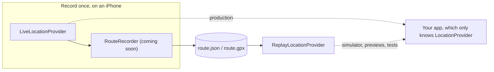

# RouteReplay
RouteReplay is an open-source Swift package (iOS 17+ / macOS 14+, Swift 6 strict concurrency, swift-tools-version 6.0, zero dependencies) that records real GPS routes and replays them as a fake location stream. Repo: github.com/ninikurshavishvili/RouteReplay (public); local checkout
Testing location features is slow. You walk or drive around with your phone, or use Xcode's GPX simulation, which is set per scheme, is hard to control while the app runs, and doesn't work in unit tests or SwiftUI previews.

RouteReplay feeds a recorded route through the same interface your app uses for real GPS. Your app code doesn't change, replay needs no location permission, and you can pause it or play it 50 times faster.

**Record a real route once, replay it anywhere: in the simulator, in SwiftUI previews and in unit tests, at any speed.**


<!-- TODO: add a GIF of the debug map replaying a route here -->

> **Status: work in progress toward v0.1.0.** Replay and JSON/GPX route files work today.
> The recorder and the debug map are next. See the [roadmap](#roadmap).


## How it works



| Type | What it is |
| --- | --- |
| `LocationProvider` | The one protocol your app depends on: `func locations() -> AsyncStream<CLLocation>` |
| `LiveLocationProvider` | Real GPS from Core Location, for production |
| `ReplayLocationProvider` | Replays a route, waiting the recorded time between points divided by the speed |
| `RecordedRoute` | A named list of points (position, altitude, accuracy, speed, course, time), saved as JSON or GPX |

## Installation

In Xcode: **File → Add Package Dependencies…** and enter:

```text
https://github.com/ninikurshavishvili/RouteReplay.git
```

Or in `Package.swift`:

```swift
dependencies: [
    // Switch to `from: "0.1.0"` once v0.1.0 is released.
    .package(url: "https://github.com/ninikurshavishvili/RouteReplay.git", branch: "main")
]
```

Requires iOS 17+ or macOS 14+ and Xcode 16+ (Swift 6). It has no dependencies.

## Quick start

**1. Depend on the protocol, not on Core Location.**

```swift
import CoreLocation
import Observation
import RouteReplay

@MainActor @Observable
final class WalkTracker {
    private(set) var lastLocation: CLLocation?
    private let provider: any LocationProvider

    init(provider: any LocationProvider) {
        self.provider = provider
    }

    func start() async {
        for await location in provider.locations() {
            lastLocation = location
        }
    }
}
```

**2. Give it real GPS in production and a replay everywhere else.**

```swift
// Production
let liveTracker = WalkTracker(provider: LiveLocationProvider())

// Simulator, previews and tests: a route file added to your app
let url = Bundle.main.url(forResource: "tbilisi-walk", withExtension: "gpx")!
let route = try RecordedRoute(contentsOf: url)
let replayTracker = WalkTracker(provider: ReplayLocationProvider(route: route, speed: 10, loop: true))
```

Replayed locations are stamped with the current time, so code that ignores old locations still accepts them.

## Controlling playback

```swift
let player = ReplayLocationProvider(route: route)

await player.pause()        // hold the next point
await player.setSpeed(20)   // 20x, from the next point on
await player.play()
await player.stop()         // pause and rewind to the first point
```

Every stream from one player shares a single playhead, so a map and a tracker that both listen to it always see the same point. Without `loop`, the streams finish after the last point.

## Route files

```swift
let route = try RecordedRoute(contentsOf: url)     // .json or .gpx, chosen by the file extension
try route.save(to: fileURL, format: .json)         // or .gpx
```

- **JSON** is RouteReplay's own format. It keeps every field, and times keep their milliseconds.
- **GPX 1.1** works with map and fitness apps. Import reads tracks, routes and Xcode's own location-simulation files, so you can replay GPX files you already have. GPX has no accuracy, speed or course fields, so imported points get 5 m accuracy, and export keeps position, altitude and time only.

```json
{
  "name": "Rustaveli walk",
  "recordedAt": "2026-10-21T10:00:00.000Z",
  "points": [
    { "latitude": 41.6977, "longitude": 44.799, "horizontalAccuracy": 5, "timestamp": "2026-10-21T10:00:00.000Z" }
  ]
}
```

## In unit tests

Replay needs no device and no permission. Use a high speed so the test finishes quickly:

```swift
@Test func replaysTheWholeWalk() async throws {
    let provider = ReplayLocationProvider(route: route, speed: 1_000)

    var count = 0
    for await _ in provider.locations() {
        count += 1
    }

    #expect(count == route.points.count)
}
```

For full control over time, pass your own `Clock` with `ReplayLocationProvider(route:speed:loop:clock:)`.

## In SwiftUI previews

```swift
#Preview {
    WalkView(tracker: WalkTracker(provider: ReplayLocationProvider(route: route, speed: 10, loop: true)))
}
```

## Permissions

- **Replay** needs none, because it never touches real GPS.
- **`LiveLocationProvider`** needs `NSLocationWhenInUseUsageDescription` in your app's Info.plist and When In Use authorization, for example `CLLocationManager().requestWhenInUseAuthorization()`.

## Roadmap

**v0.1.0**
- [x] `LocationProvider`, `LiveLocationProvider`, `ReplayLocationProvider` (speed, pause, stop, loop)
- [x] JSON and GPX import and export
- [ ] `RouteRecorder` with accuracy and distance filtering
- [ ] `RouteDebugMap`: a SwiftUI map with the route line, a moving dot and play controls
- [ ] A bundled sample route for previews
- [ ] DocC documentation and CI

**Later** ([IDEAS.md](IDEAS.md)): seek, smooth interpolation, background recording, KML and GeoJSON, a geofence debugger, a Flutter plugin.

## Contributing

Issues and pull requests are welcome. Run the tests with:

```bash
swift test
```

and on an iOS Simulator you have installed, for example:

```bash
xcodebuild test -scheme RouteReplay -destination 'platform=iOS Simulator,name=iPhone 16'
```

## License

MIT. See [LICENSE](LICENSE).
